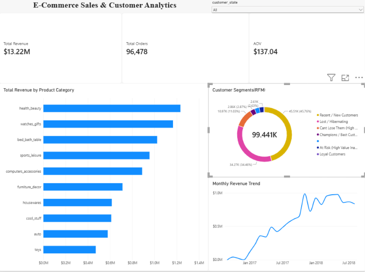

# E-commerce_executive_dashboard

An executive-level end-to-end sales and customer analytics dashboard built on the Brazilian E-Commerce (Olist) public dataset, utilizing Python, SQLite, DAX, and Power BI.

---

## 📊 Dashboard Preview


---

## 📌 Executive Summary
This project analyzes operational e-commerce data covering ~100k customer orders. The objective is to evaluate gross revenue performance, identify top-selling product categories, uncover historical sales trends, and segment customers using behavioral RFM (Recency, Frequency, Monetary) modeling to inform retention strategies.

### Core Business KPIs
* **Total Revenue:** $13.22M
* **Total Orders:** 96,683 (Delivered orders)
* **Average Order Value (AOV):** $137.04
* **Total Tracked Customers:** 99,441

---

## 🏗️ Data Architecture & Star Schema
Raw operational tables were cleaned, staged via SQLite, and modeled into an optimized Star Schema within Power BI:

* **`fact_sales_orders` (Fact Table):** Contains transactional grain with `order_id`, `customer_id`, `order_date`, `order_year_month`, `price`, `freight_value`, and `order_status`.
* **`dim_customers` (Dimension Table):** Contains customer demographics (`customer_city`, `customer_state`), along with calculated behavioral RFM scores and segments (`rfm_segment`).
* **`dim_products` (Dimension Table):** Contains catalog information including `product_id` and normalized `product_category`.

---

## 🎯 Customer RFM Segmentation
Customers are categorized based on behavioral quartiles:
* **Recent / New Customers (~45.8%):** Recently acquired shoppers suitable for immediate cross-sell and onboarding flows.
* **Lost / Hibernating (~34.5%):** Inactive buyers with high recency dormancy requiring targeted win-back campaigns.
* **Champions & Loyal Customers (~13.9%):** High-monetary, reliable buyers generating steady margins.
* **At Risk (~5.8%):** Former high spenders who haven't ordered recently.

---

## 📐 Key DAX Measures

```dax
// Total Revenue from Delivered Orders
Total Revenue = 
SUM(fact_sales_orders[price])

// Distinct Completed Orders Formatted with Thousands Separator
Total Orders = 
FORMAT(DISTINCTCOUNT(fact_sales_orders[order_id]), "#,##0")

// Average Order Value
AOV = 
DIVIDE([Total Revenue], DISTINCTCOUNT(fact_sales_orders[order_id]), 0)